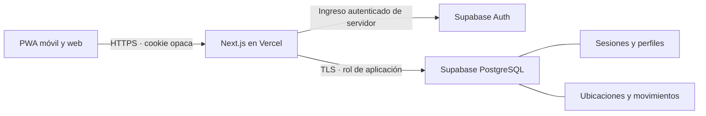
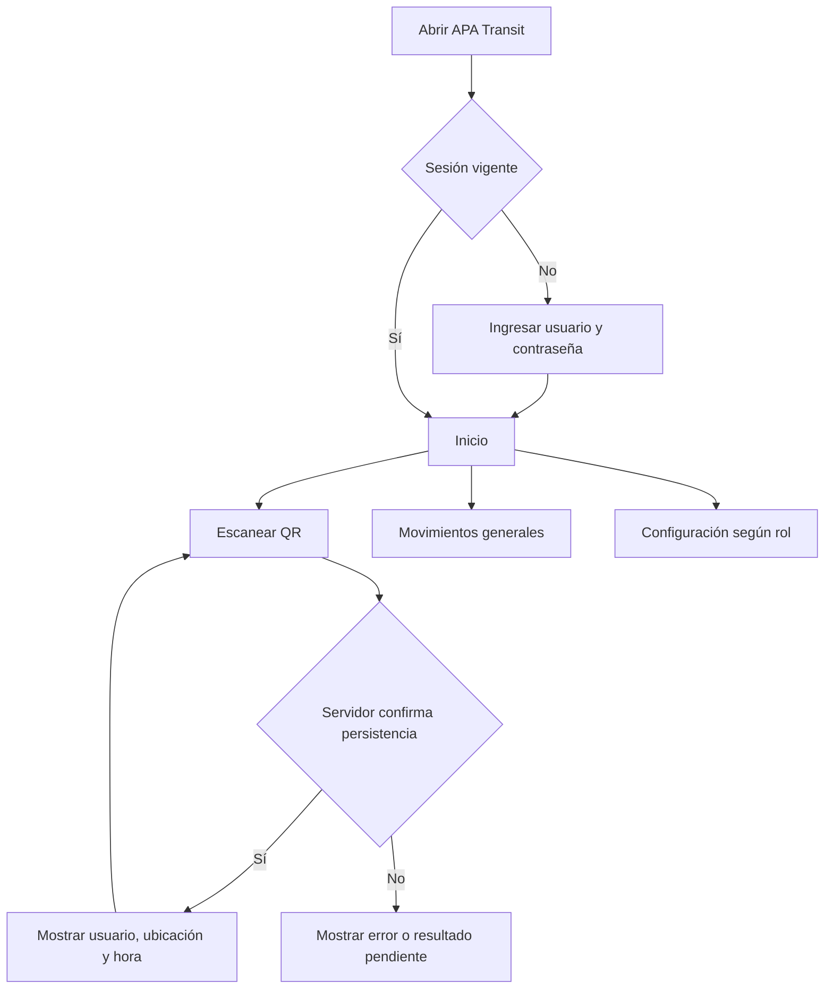
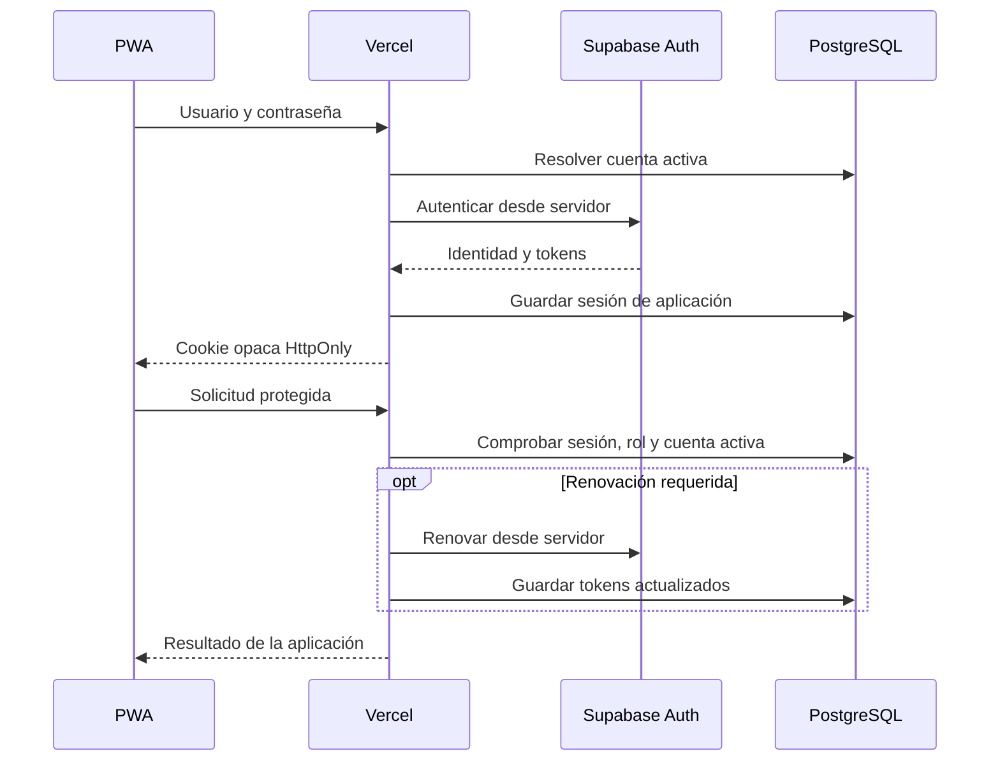

# Arquitectura

Next.js con TypeScript ejecuta React y los Route Handlers en Vercel. La PWA usa Tailwind CSS y shadcn/ui. La cámara se maneja en cliente con html5-qrcode, la generación PNG con qrcode y la validación HTTP con Zod. Supabase aporta Auth y PostgreSQL. Los límites de acceso se detallan en [Seguridad](SECURITY.md).

## Flujo operativo

Tras decodificar el QR, la PWA detiene lecturas consecutivas, asigna un UUID a la captura y envía el movimiento al backend. El servidor comprueba la sesión y la ubicación y responde al confirmar la transacción. El historial y el último movimiento propio se obtienen de PostgreSQL. Las lecturas, cambios administrativos y respuestas autenticadas se solicitan en línea y con `Cache-Control: no-store`. La instalación PWA puede almacenar recursos públicos estáticos.

## Sesiones y límites de confianza

El navegador usa únicamente la API del origen de la PWA. El servidor resuelve el nombre de usuario y verifica la identidad mediante Supabase Auth usando un cliente por operación con persistencia local desactivada. La identidad de Auth debe coincidir con la cuenta resuelta. El acceso a PostgreSQL usa TLS y permisos de aplicación acotados. Separa ese acceso del cliente administrativo de Auth.

La cookie identifica una fila de sesión. Una misma sesión se comparte entre solicitudes concurrentes y se consulta con el perfil vigente. Serializa renovaciones por sesión mediante un bloqueo distribuido con vencimiento acotado o bloqueo de fila. Guarda la nueva pareja de tokens de forma atómica y comprueba que la revocación sigue sin haberse aplicado antes de publicar el resultado. Si la renovación falla de forma irrecuperable, invalida la sesión y solicita login. Ante una falla transitoria, devuelve un error reintentable. El [modelo de datos](DATABASE.md) describe la persistencia.
