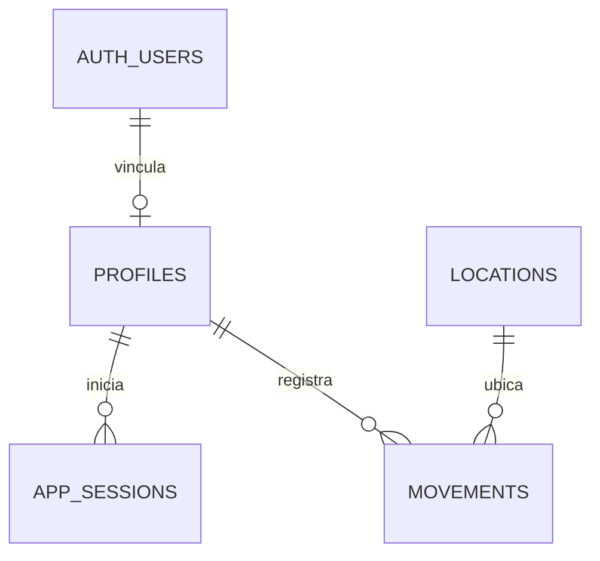

# Base de datos

| Tabla | Campos y restricciones mínimas |
|---|---|
| `profiles` | `id uuid` PK y FK a `auth.users.id`, `username` normalizado único, `full_name`, `email`, `role` en `admin/operator`, `is_active`, `deleted_at`, marcas UTC. Un perfil eliminado permanece inactivo. |
| `locations` | `id uuid` PK, `name`, `qr_token uuid` único e inmutable, `is_active`, marcas UTC. |
| `movements` | `id uuid` PK, `user_id` y `location_id` FK restrictivas, `user_name_snapshot`, `location_name_snapshot`, `request_id uuid` y `recorded_at timestamptz`. Único por `(user_id, request_id)`. |
| `app_sessions` | Hash único de la cookie, `user_id` FK, tokens Auth cifrados, fechas de creación y vencimiento, fecha de revocación. Índice por usuario para revocación. |

El borrador local agrega `auth_version` en perfiles. Los cambios de usuario,
correo, rol, activación, bloqueo o borrado lógico incrementan esa versión y revocan
las sesiones mediante triggers, dentro de la misma transacción. El login compara
la versión anterior y posterior a Auth para rechazar una autenticación que quedó
obsoleta durante una modificación administrativa. El nombre visible por sí solo
no revoca sesiones.

El bloqueo temporal usa `blocked_at`; es independiente de `is_active` y
`deleted_at`. `admin_operations` reserva operaciones pendientes sin contraseñas;
`audit_events` registra metadatos administrativos y `rate_limits` conserva buckets
de intentos con claves hash. Los flujos de administración y reconciliación aún
están pendientes. Ninguna migración de este borrador se ha aplicado al proyecto remoto.

Usa un esquema privado. Activa RLS en las tablas de aplicación y concede permisos explícitos al rol de servidor correspondiente. Retira acceso y ejecución de funciones a `PUBLIC`, `anon` y `authenticated`. El propietario de migraciones es distinto del rol de ejecución. Restringe los movimientos a inserción y lectura mediante rutas autorizadas. El rol de aplicación carece de permisos de actualización y borrado sobre movimientos.

## Registro transaccional

1. Comprueba la sesión y bloquea el perfil en un modo compatible con consultas, pero incompatible con una desactivación concurrente. Aplica un orden de bloqueos uniforme. Verifica cuenta activa y sin borrado lógico.
2. Valida el formato del QR, resuelve su token y busca un registro para `(user_id, request_id)`. Si existe y corresponde a esa ubicación, devuelve el registro original aunque la ubicación se haya desactivado. Si corresponde a otra, devuelve conflicto.
3. Para una captura nueva, comprueba que la ubicación siga activa bajo el bloqueo correspondiente. Inserta las referencias, los nombres vigentes y la hora de PostgreSQL. Resuelve la carrera de inserciones con la restricción única y relee el registro ganador para aplicar la misma comprobación.
4. Confirma la transacción antes de responder. La desactivación de una cuenta revoca sus sesiones en la misma transacción de aplicación.

Indexa `(recorded_at DESC, id DESC)` para el historial y `(user_id, recorded_at DESC, id DESC)` para el último movimiento propio. Usa ambos campos como cursor de orden total. Almacena fechas UTC y renderiza con la zona IANA `America/Santiago`.

## Consistencia de cuentas

Los cambios entre Auth y PostgreSQL cruzan dos sistemas. En altas, reserva unicidad y mantén el perfil fuera de operación hasta confirmar Auth y su enlace. Si queda una identidad huérfana, el login debe rechazarla y el administrador puede reconciliarla. Para cambios de correo o contraseña, bloquea login y revoca sesiones antes de llamar a Auth. Finaliza el cambio de perfil solo tras confirmar el resultado. Si el resultado es incierto, conserva el bloqueo, revisa el estado usando Auth Admin y reintenta con una decisión administrativa. Nunca guardes contraseñas en la operación pendiente. Separa bloqueo temporal, desactivación y borrado lógico en la implementación.
